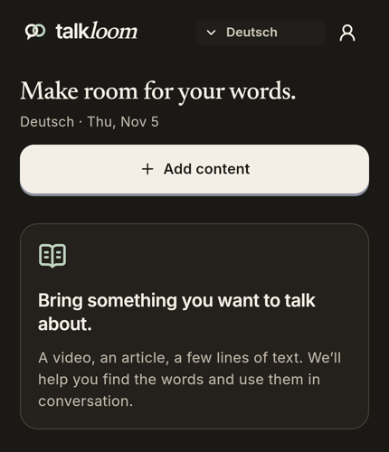
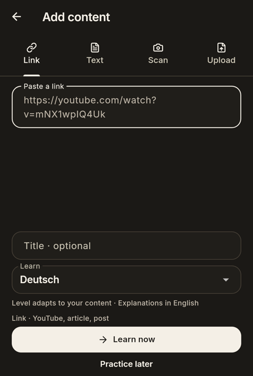
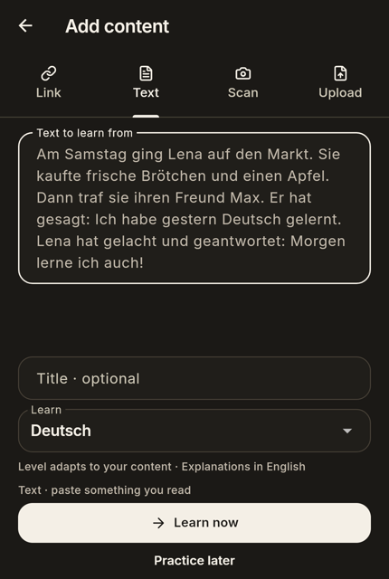
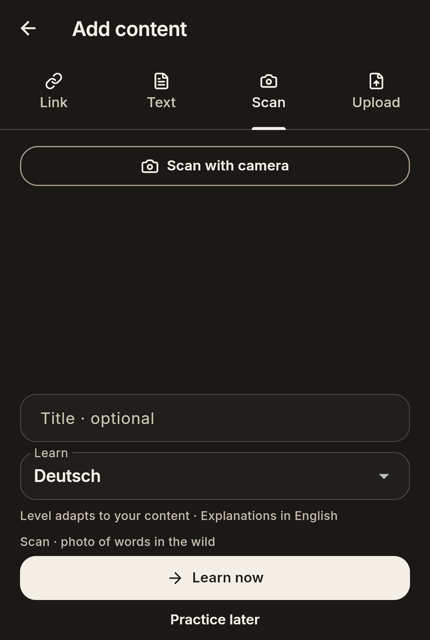
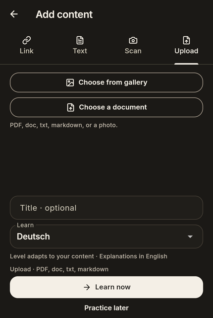
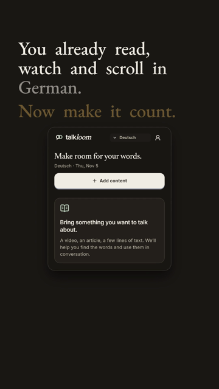
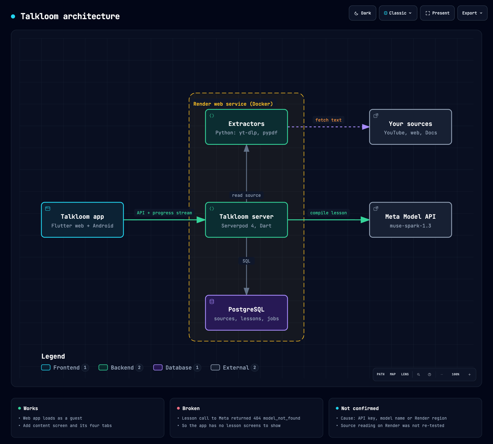

# Talkloom

Talkloom is a web and Android app for learning German from things you already read or watch. You paste a link, some text, a photo or a file, and the app is meant to turn it into German practice that matches your level. Explanations are in English.

The app opens as a guest, so there is no login. The live site is https://talkloom.onrender.com.

Status on 5 November 2026: the app opens and the Add content screen works, but lesson generation is broken on the server. Nobody can get a lesson out of it right now. The cause is not confirmed yet. The section "The Render problem" below has everything we know.

## Screens

These are real screenshots of the live app, taken at 430 x 932.

<p>
  
  
  
  
  
</p>

From left to right: Home, Link, Text, Scan, Upload. Every tab has an optional title, a "Learn" language (Deutsch), a "Learn now" button and a "Practice later" button. The hint under the fields reads "Level adapts to your content, Explanations in English".

There are no lesson screenshots because we could not get a lesson to generate.

## Video

A 50-second vertical promo, made with HyperFrames from the screenshots above and a German line spoken by a macOS voice. It stops at the Add content screen on purpose, since the lesson screens were not available.

[](https://youtube.com/shorts/cvuMRa4yDLs)

Watch it here: https://youtube.com/shorts/cvuMRa4yDLs

## How it works



The interactive version is in [assets/readme/architecture.html](assets/readme/architecture.html). Download it and open it in a browser to zoom and trace paths.

When you tap "Learn now", this is the path the code follows:

1. The Flutter app sends the link, text or file to the Talkloom server (Serverpod 4, written in Dart) and gets back an import job.
2. The server reads the source. YouTube links use captions through `youtube-transcript-api`, with an audio fallback through `yt-dlp` and Meta transcription for videos without captions. PDFs go through `pypdf`, Word files through a DOCX script, and Google Docs links are fetched directly. Photos are read with OCR through the Meta model.
3. The server sends the text to the Meta Model API (`https://api.meta.ai/v1`) and asks for a lesson. It checks the answer, repairs it if needed and saves it in PostgreSQL.
4. The app follows the job through the stages `queued`, `fetching`, `transcript`, `compiling`, `validating` and `saved` over a stream. If a stage fails, the learner sees a plain message instead of a server error.

Other parts that exist in the code:

- Speech: spoken voices come from a self-hosted Piper worker. The Meta API has no speech synthesis. If the worker is down, the app uses on-device voices.
- Cost guard: every paid AI call counts against a daily quota. A guest gets 3 imports a day, a registered learner gets 10. Render environment variables such as `AI_QUOTA_ENABLED` change the limits.
- Practice, a voice arena, a source reader and a profile screen are in the Flutter app. We have not tested any of them against the live server.

## What works

We checked these on 5 November 2026.

- The live site answers with HTTP 200 and opens as a guest.
- The Home screen shows "Make room for your words.", the Add content button, the Home / My learning / Profile bar and the "Deutsch" language chip.
- The Add content screen has the Link, Text, Scan and Upload tabs. Typing a link and pasting a short German story into the fields works.
- The promo video renders from these screens, offline, in about 25 seconds.

We did not press "Learn now" while testing, so nothing was written to the live database.

## What does not work

- Lesson generation. A source goes in and no lesson comes out. This is the main problem.
- Everything that depends on a lesson: lesson screens, practice sessions, mastery and the tutor. We could not reach them, so we do not know if they are fine.

## The Render problem

"Render" here means the hosting service where the server runs, not the video render. The promo video rendered without trouble.

The server makes its lesson with a call to the Meta Model API. The model names are set in [`meta_models.dart`](talkloom/talkloom_server/lib/src/services/meta_models.dart): `muse-spark-1.3-contributor` for text and `muse-spark-1.3` for images and video.

From the commit history, the call fails on Render with an HTTP 404 and the error code `model_not_found`. The import job then ends as `failed`, and the learner sees "Talkloom could not prepare this source."

What we tried, in order:

1. `1a20c144`: print import failures to stderr. Serverpod writes its session log to the database, so Render's Logs tab showed nothing.
2. `3f6ea399`: move text calls to the contributor model and put image and video calls on a separate model.
3. `bbc6f35e`: on a 404, log a short SHA-256 of the API key and the list of models that key can see. This lets us compare the key on Render with the key we meant to use, without printing it.
4. `067f50e9`: add a small test service in [`tools/egress-probe`](tools/egress-probe) that asks the Meta API for its model list from a given Render region.
5. `b941ee74` and `582a927b`: lower the OCR reasoning effort and keep more of the error text in the logs so the model list is readable.

There are three suspects, and we have not ruled any of them out:

- The API key on Render cannot see the contributor model.
- The model name is wrong or has changed.
- The Meta API refuses traffic from the Render region the server runs in.

We have not seen the Render logs after the last commit, so we do not know which one it is.

To find out:

1. Open the Render dashboard, then the Logs tab of the server, and run one import. Look for the line that ends with `[requested=... key_sha256=... visible_models=...]`.
2. Run `printf %s "$KEY" | shasum -a 256 | cut -c1-8` on the key you meant to use and compare it with `key_sha256`. A different value means the wrong key is set.
3. If the hash matches and `visible_models` lacks the requested model, the key has no access to it. Change the model in `meta_models.dart` to one that is listed.
4. If `visible_models` shows `HTTP 401` or `HTTP 403`, or the request fails before an answer, deploy the probe in the same region, set `META_KEY`, and open its URL. It prints the status code and model ids, never the key.

## Repository layout

| Folder | What is in it |
| --- | --- |
| `talkloom/talkloom_flutter` | The Flutter app for web and Android |
| `talkloom/talkloom_server` | The Serverpod server, extraction scripts and the Dockerfile |
| `talkloom/talkloom_client` | Generated client code shared by the app |
| `talkloom/web_dist` | The production web build the server serves |
| `tools/egress-probe` | The temporary Meta API test service |
| `assets/readme` | Screenshots and the architecture diagram used in this file |

## Run it yourself

We did not run these commands while writing this README, so treat them as a starting point. You need Dart 3.12, Flutter, Docker (for PostgreSQL) and the Serverpod CLI.

```bash
cd talkloom/talkloom_server
serverpod start
```

AI features need a Meta API key in `config/passwords.yaml` under `development: metaApiKey`. That file is not committed. Without a key the app starts, but lessons cannot be made.

The server image is built from the repository root:

```bash
docker build -f talkloom/talkloom_server/Dockerfile -t talkloom-server .
```

## License

MIT. See [LICENSE](LICENSE).
